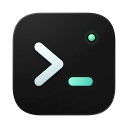
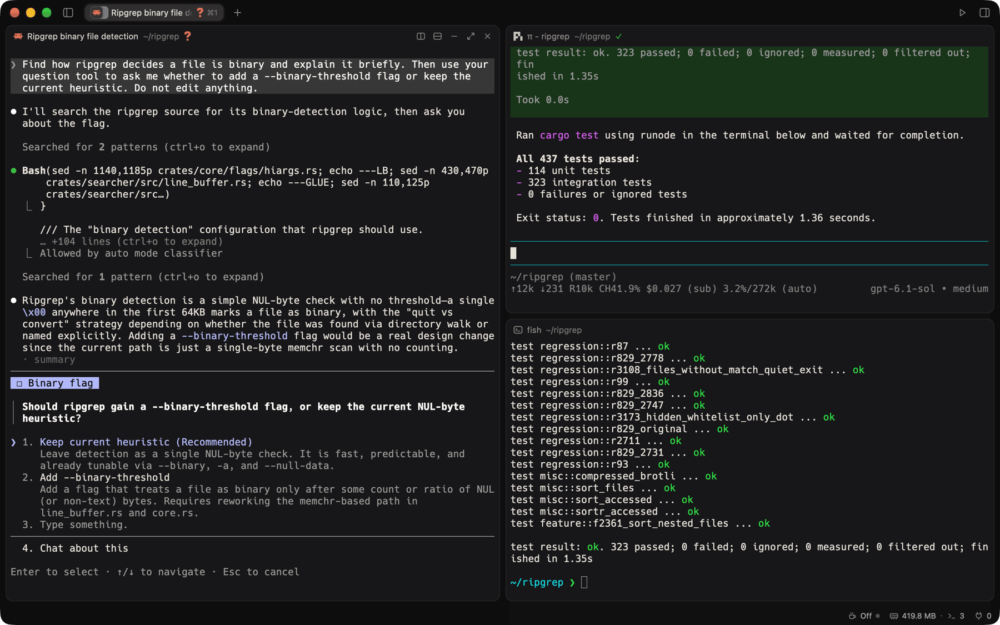
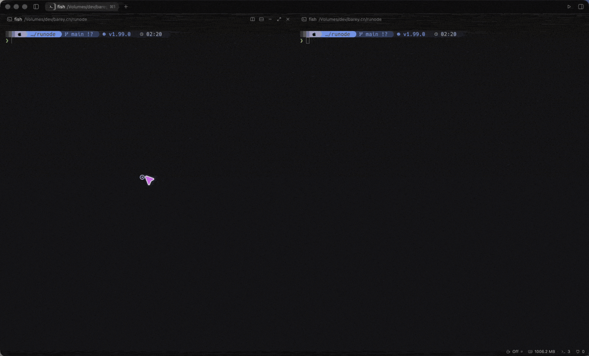
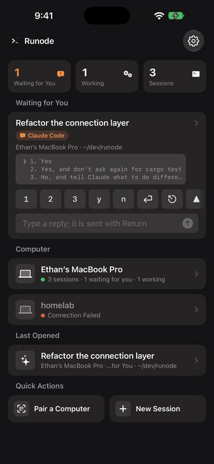
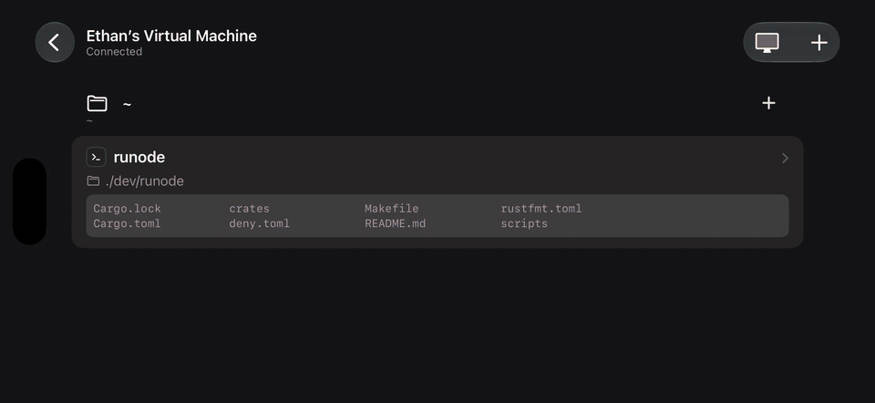
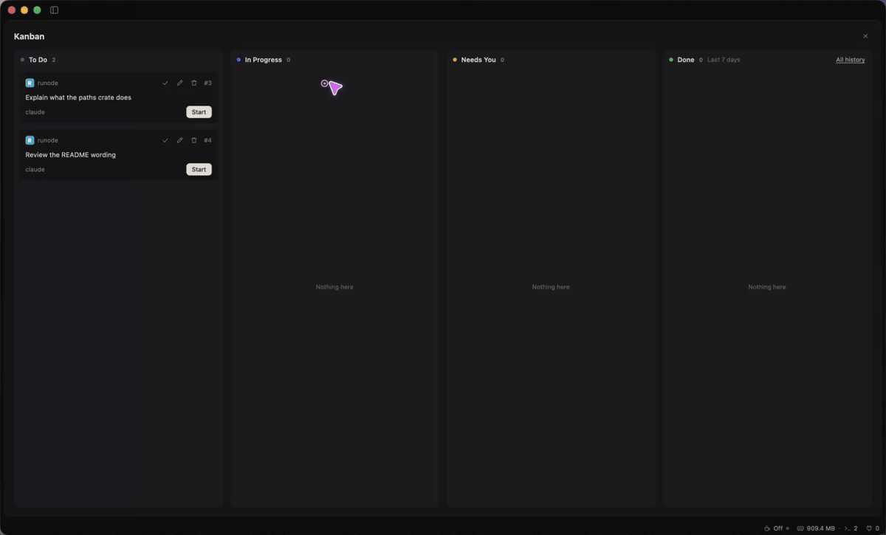
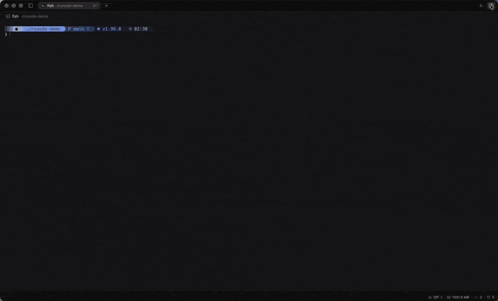

<p align="center">
  
</p>

<h1 align="center">Runode</h1>

<p align="center">
  A native terminal for macOS, Windows and Linux, built for AI coding agents
  <br>
  <a href="#install">Download</a>
  ·
  <a href="#quick-start">Quick start</a>
  ·
  <a href="CONTRIBUTING.md">Contributing</a>
  ·
  <a href="README.zh-CN.md">简体中文</a>
</p>

<p align="center">
  
</p>

## About

Running several Claude Code and Codex sessions at once means constantly switching terminals to see which one finished and which one is waiting for you. Runode recognizes the agent in every terminal and tracks its state with no hooks to configure, and lets you know when one needs you. Agents can drive the terminals next to them too, running tests and reading the output themselves. Projects on other machines open over SSH, with the terminal, file tree and Git panel working directly on that machine. When you're away from your desk, pick up where you left off on your phone.

Runode uses [Ghostty](https://ghostty.org)'s libghostty-vt for terminal emulation and [GPUI](https://www.gpui.rs) for a fully GPU-rendered UI.

## Features

- **Agent-aware**: recognizes 20+ agents, including Claude Code, Codex, Gemini CLI, Cursor, OpenCode and Amp, and marks each tab and sidebar entry as working, waiting for you, or done but unread.
- **Notifications and jumping**: notifies you and plays a sound when you're not looking. `⌘⇧A` lists the agents in every window, and `⌘⌥A` jumps straight to the next one that needs you. Notifications that programs send with OSC 9 or OSC 777 become system notifications too.
- **Start agents from the tab menu**: the new tab menu lists the agents installed on the workspace's machine, local or over SSH, and starts one in a new tab; `⌃⌘1` to `⌃⌘9` open them by number. On Windows it also picks between PowerShell, Command Prompt and Git Bash.
- **Scriptable**: the built-in `runode` CLI lists, reads and drives every terminal. Agents use it to run commands in a neighbouring pane, wait for them, read the output, or direct another agent.
  <br>
- **Persistent sessions**: with `terminal-host` on, sessions live in a separate host process and survive quitting, relaunching and upgrading the app. A pane that has to start over picks its Claude Code conversation back up.
- **SSH hosts**: pick a host when you create a workspace. Runode connects with your system's OpenSSH, installs runode there when needed and reconnects after a drop. Terminals, the file tree, the Git panel and previews work directly on that machine, whether it runs macOS, Linux or Windows. Pasted screenshots and dropped files are uploaded to it, and localhost links are forwarded to your machine.
- **Pair another computer**: pair with Runode on another computer and use its terminals, files, Git, port forwarding and remote desktop the same way as an SSH host.
- **Remote from your phone**: the iOS and Android apps pair with your computer over a TLS 1.3 connection. On the same network it connects directly; once you set the network to 0.0.0.0 when pairing, it also reaches your computer from elsewhere through [iroh](https://iroh.computer) by public key, punching a direct path and falling back to a relay. From your phone you can watch terminals, answer agents, start a new agent, run tasks and commit to git.
  <br>
- **Remote desktop**: see and control a whole screen from your phone, or from Runode on another computer over SSH or pairing. Macs, Windows PCs and Linux machines can all be viewed, with low-latency hardware encoding. It can switch displays and unlock a locked screen with a password you saved.
  <br>
- **Voice input**: dictate into the terminal on your computer or your phone. Speech is recognized offline with a local model; cloud recognition and polishing the text with an LLM are optional.
- **Task board**: a kanban board for agent work. A schedule opens a terminal and starts an agent on a task at the time you set, and a task whose PR gets merged is marked done. Agents use it too, through `runode todo` and `runode schedule`.
  <br>
- **Floating panes**: float a pane over the others and dock it back, move panes between tabs and workspaces, or drag a terminal or remote desktop out into a window of its own.
- **Project commands**: `⌘⇧R` lists the project's Makefile targets, package.json scripts and commands you add yourself. They run in a split beside you, and each project can bind its own shortcuts to them.
- **Project panels**: a file tree, syntax-highlighted previews you can edit and save, and a Git panel that can stage hunks, commit, switch branches, and pull or push. An LLM can write the commit message, a diff hunk goes to the agent in the current terminal with one click, and a GitHub Actions page shows the repository's workflow runs.
  <br>
- **Status bar**: keeps the computer awake while an agent works, shows memory use and listening ports, and forwards ports from SSH hosts to your machine.
- **Ghostty compatible**: reads your existing Ghostty config and themes. Images sent with the Kitty graphics protocol, such as from `kitten icat`, show up on your computer and your phone.
- **Native**: written in Rust, not Electron. The UI comes in English, Simplified Chinese and Traditional Chinese, and the app updates itself.

## Install

On macOS, run this in a terminal:

```sh
curl -fsSL https://raw.githubusercontent.com/runode-dev/runode/main/scripts/install.sh | sh
```

It installs Runode.app into Applications and links the `runode` command line into the first writable bin directory on your PATH (`~/.local/bin`, `~/bin`, `/opt/homebrew/bin`, `/usr/local/bin`; falls back to `~/.local/bin`). You can also download the dmg for your Mac yourself from the [latest release](https://github.com/runode-dev/runode/releases/latest). Open it and drag Runode into Applications. It is signed with a Developer ID, notarized by Apple, and keeps itself up to date.

On Windows (x86_64), download `Runode-<version>-windows-x86_64-setup.exe` from the [latest release](https://github.com/runode-dev/runode/releases/latest). It installs per user without admin rights, puts the `rn` command line on your PATH and updates itself. The installer is signed with a self-signed certificate, so SmartScreen warns on the first run.

On Linux (x86_64 and aarch64), the same install script installs the desktop app as an AppImage in a graphical session, adds it to the application menu and keeps it up to date; it needs FUSE (`fuse3`). Prefer your package manager? Download the `.deb` or `.rpm` from the [latest release](https://github.com/runode-dev/runode/releases/latest) instead; these don't update themselves, so install each new version the same way. On a server without a desktop, the script installs just the command line and the terminal host.

Every version is on [Releases](https://github.com/runode-dev/runode/releases). The iOS and Android apps aren't in the App Store or Google Play yet; [build them from source](CONTRIBUTING.md).

## Quick start

Teach your agents how to use runode by installing its skill (works with Claude Code, Codex and other agents):

```sh
npx skills add runode-dev/runode --skill runode -g
npx skills update runode -g    # later, to get the latest version
```

From then on the agent drives neighbouring terminals when it needs to. You can use it by hand as well:

```sh
runode list                                    # list every terminal and the agent in it
runode send right 'cargo test' --enter --wait  # run tests in the pane to the right and wait
runode read right --command                    # read back that command's output
runode remote pair                             # show a QR code to pair your phone
```

Run `runode help` for the full reference; on Windows the command is `rn`. The config file lives at `~/.runode/config.conf`. Tab completion for `runode` and `rn` comes from `runode completions bash|fish|zsh` (see `runode help completions` for where to put it).

## FAQ

**How does Runode relate to Ghostty?**
Runode is not a fork of Ghostty. It uses libghostty-vt as a terminal emulation library; the UI, splits and agent detection are its own.

**Which agents does it work with?**
Any agent that runs in a terminal. More than 20 have their state recognized, including Claude Code, Codex, Gemini CLI, Cursor, OpenCode, Amp, GitHub Copilot, Kimi and Qwen Code, and you can add your own detection rules.

**Which platforms are supported?**
The desktop app runs on macOS (Apple silicon and Intel), Windows (x86_64) and Linux (x86_64 and aarch64, as an AppImage, deb or rpm), and iOS and Android apps give remote access. Linux servers without a desktop get the command line and the terminal host; reach them from your phone, or open them as an SSH host from Runode on another computer. SSH hosts can run macOS, Linux or Windows, including ARM64.

## Contributing

Issues and PRs are welcome. See [CONTRIBUTING.md](CONTRIBUTING.md) for building and [AGENTS.md](AGENTS.md) for the code layout and conventions.

## License

[Apache-2.0](LICENSE)
